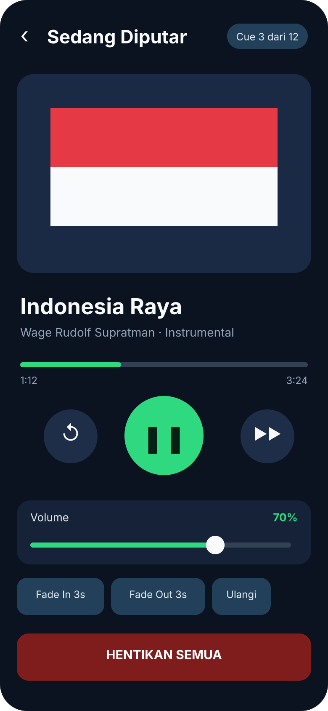
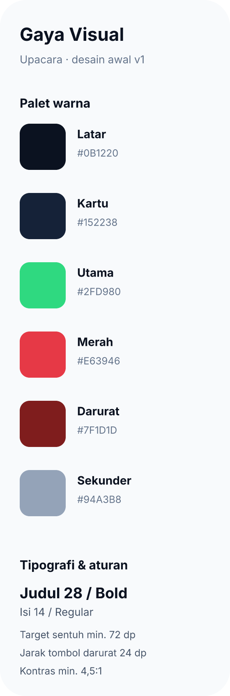
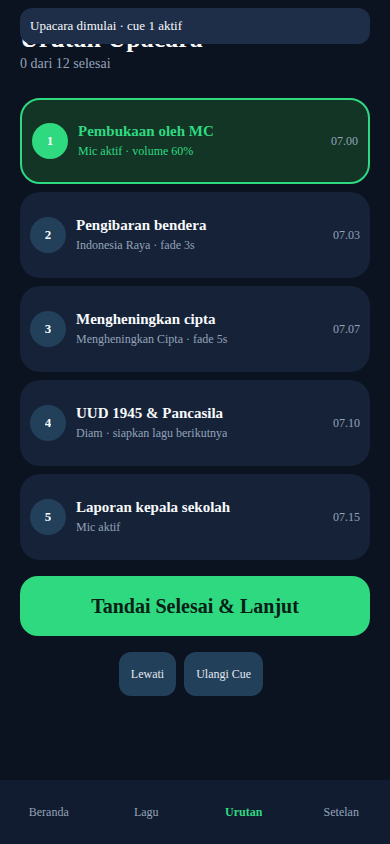
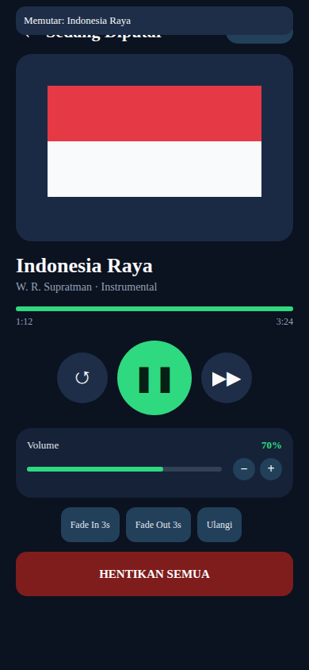

# Upacara — Sound System Upacara Sekolah

Aplikasi Android/offline-first untuk operator sound system upacara Senin di sekolah. Dibangun dengan **Lynx + ReactLynx + Rspeedy + TypeScript**, dengan **Bun** sebagai runtime dan package manager.

> **Status saat ini:** UI selesai dan bisa dijalankan di browser. Modul native Android untuk audio (`MediaPlayer`) dan penyimpanan (`SharedPreferences`) sudah disiapkan; browser memakai simulasi audio + session storage Lynx karena runtime Lynx tidak menyediakan Web Audio/localStorage.

**Repository:** [github.com/hex4coder/apps-upacara](https://github.com/hex4coder/apps-upacara)

---

## Isi repository

```text
apps-upacara/
├── README.md              # dokumentasi ini
├── upacara/               # proyek aplikasi Lynx + Bun
│   ├── src/               # UI + adapter audio/storage
│   └── native/            # source module Android (Kotlin)
└── design/                # desain visual FigCraft + preview PNG
```

- **`upacara/`** — source code aplikasi, konfigurasi Lynx/Rspeedy, aset, tes, dan module native Android.
- **`design/`** — file desain `upacara-ui-v1.figcraft`, preview FigCraft, dan screenshot hasil render di browser.

---

## Desain aplikasi

Desain dibuat lebih dulu di **FigCraft**, sebelum kode aplikasi ditulis. File sumber dan hasil ekspornya ada di folder [`design/`](design/).

### File desain

- [`design/upacara-ui-v1.figcraft`](design/upacara-ui-v1.figcraft) — 5 frame:
  1. `01 - Beranda`
  2. `02 - Pustaka Lagu`
  3. `03 - Pemutar`
  4. `04 - Urutan Upacara`
  5. `05 - Gaya Visual` (palet warna, tipografi, aturan target sentuh)

### Preview FigCraft

| Beranda | Pustaka Lagu |
| --- | --- |
|  |  |

| Pemutar | Urutan Upacara |
| --- | --- |
|  |  |



### Hasil render di browser

Screenshot ini diambil dari web preview Lynx pada viewport 390×844.






### Sistem warna

| Peran | Warna |
| --- | --- |
| Latar utama | `#0B1220` |
| Kartu | `#152238` |
| Hijau utama / aksi | `#2FD980` |
| Teks utama | `#F8FAFC` |
| Teks sekunder | `#94A3B8` |
| Merah bendera | `#E63946` |
| Merah darurat | `#7F1D1D` |

Aturan aksesibilitas: target sentuh minimal **72 dp**, jarak tombol darurat **24 dp**, kontras teks minimal **4,5:1**.

---

## Fitur MVP

1. **Beranda** — status offline, jam upacara, tombol mulai, ringkasan 5 cue pertama.
2. **Pustaka Lagu** — daftar lagu nasional/offline dengan filter kategori.
3. **Pemutar** — play/pause, volume, fade in/out, ulangi, dan tombol darurat dua langkah.
4. **Urutan Upacara** — 12 cue dengan jam, catatan operator, progres, dan lagu terkait.
5. **Setelan** — durasi fade, volume maksimal aman, perangkat audio, kontras tinggi.

Kandidat lagu awal mencakup **Indonesia Raya**, **Mengheningkan Cipta** (*Truno Prawit* — sebelumnya disebut “Hening Cipta”), **Garuda Pancasila**, **Gugur Bunga**, **Bangun Pemudi Pemuda**, **Maju Tak Gentar**, **Tanah Airku**, dan **Doa (Nada Khidmat)**.

---

## Menjalankan aplikasi

Prasyarat: **Bun** ≥ 1.4.

```bash
cd upacara
bun install
bun run dev
```

Terminal akan menampilkan dua target:

- **Lynx** — `http://<ip>:3000/main.lynx.bundle` → pindai dengan Lynx Explorer.
- **Web Preview** — `http://<ip>:3000/__web_preview?casename=main.web.bundle` → buka di browser.

Secara lokal:

```text
http://localhost:3000/__web_preview?casename=main.web.bundle
```

Build produksi:

```bash
bun run build
```

Hasilnya:

- `upacara/dist/main.lynx.bundle` untuk host Lynx/Android
- `upacara/dist/main.web.bundle` untuk Lynx for Web

---

## Arsitektur singkat

```text
upacara/src/
├── App.tsx        # state aplikasi, navigasi, aksi operator
├── screens.tsx    # Beranda, Pustaka Lagu, Pemutar, Urutan, Setelan
├── ui.tsx         # bottom navigation
├── data.ts        # daftar lagu + 12 cue upacara
├── App.css        # gaya visual sesuai design/
└── index.tsx      # entry point ReactLynx
```

Konfigurasi web/native ada di [`upacara/lynx.config.ts`](upacara/lynx.config.ts) melalui:

```ts
environments: {
  lynx: {},
  web: {},
}
```

---

## Batasan saat ini

- Browser preview memakai **simulasi audio** (progress bar berjalan, tanpa suara) karena runtime Lynx tidak memiliki Web Audio.
- Penyimpanan di browser memakai `lynx` session storage, jadi tidak bertahan setelah aplikasi ditutup.
- Module Kotlin untuk `MediaPlayer` dan `SharedPreferences` sudah ada di [`upacara/native/`](upacara/native/), tetapi host APK belum dibuat karena Android SDK tidak tersedia di mesin ini.
- File audio produksi belum disertakan; perlu rekaman/aransemen instrumental yang legal.

---

## Rencana berikutnya

1. Buat host Android dengan `LynxView` dan daftarkan module di `upacara/native/`.
2. Salin `dist/main.lynx.bundle` ke `assets/` host Android.
3. Tambahkan file audio legal ke `assets/audio/<id>.mp3`.
4. Uji lapangan bersama operator sound system sekolah.
