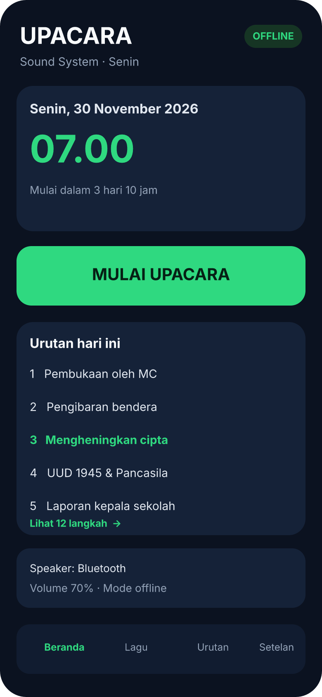
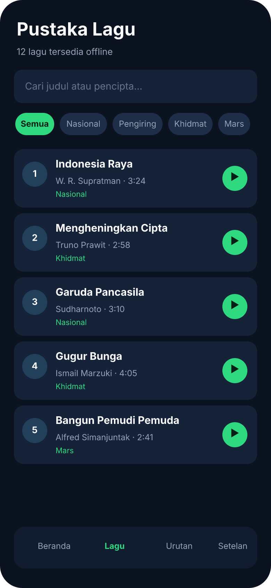
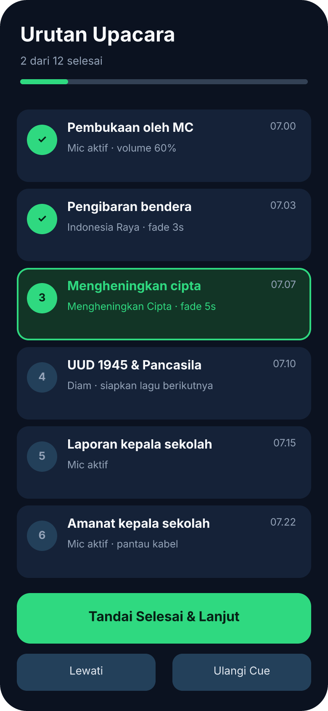
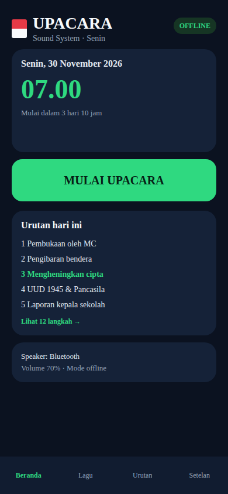
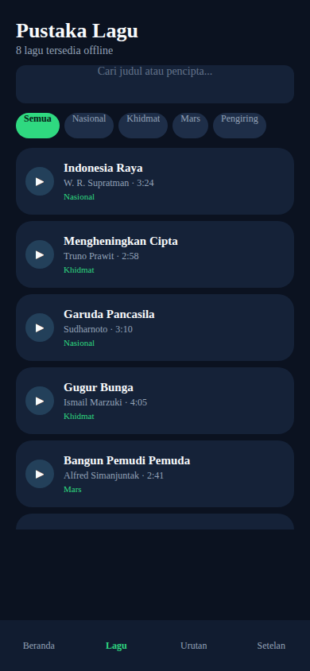

# Upacara — Sound System Upacara Sekolah

Aplikasi Android/offline-first untuk operator sound system upacara Senin di sekolah. Dibangun dengan **Lynx + ReactLynx + Rspeedy + TypeScript**, dengan **Bun** sebagai runtime dan package manager.

> **Status saat ini:** UI selesai dan bisa dijalankan di browser. Modul native (`MediaPlayer` + `SharedPreferences`), host Android `LynxView`, dan 7 MP3 legal sudah disertakan. **APK debug berhasil di-build** di `upacara/android/app/build/outputs/apk/debug/app-debug.apk`. Browser memakai simulasi audio + session storage Lynx karena runtime Lynx tidak menyediakan Web Audio/localStorage. `gugur-bunga` sengaja tidak disertakan karena belum ada rekaman berlisensi yang diizinkan.

**Repository:** [github.com/hex4coder/apps-upacara](https://github.com/hex4coder/apps-upacara)

---

## Isi repository

```text
apps-upacara/
├── README.md              # dokumentasi ini
├── AUDIO_CREDITS.md       # sumber, lisensi, dan checksum audio
├── upacara/               # proyek aplikasi Lynx + Bun
│   ├── src/               # UI + adapter audio/storage
│   ├── native/            # source kanonik module Android (Kotlin)
│   └── android/           # host Android (Gradle + LynxView + MP3)
└── design/                # desain visual FigCraft + preview PNG
```

- **`upacara/`** — source code aplikasi, konfigurasi Lynx/Rspeedy, aset, tes, module native, dan host Android.
- **`design/`** — file desain `upacara-ui-v1.figcraft`, preview FigCraft, screenshot hasil render di browser, dan pointer singkat ke sumber audio.

---

## Desain aplikasi

Desain dibuat lebih dulu di **FigCraft**, sebelum kode aplikasi ditulis. File sumber dan hasil ekspornya ada di folder [`design/`](design/).

### File desain

- [`design/upacara-ui-v1.figcraft`](design/upacara-ui-v1.figcraft) — 5 frame:
  1. `01 - Beranda`
  2. `02 - Pustaka Lagu`
  3. `03 - Pemutar`
  4. `04 - Urutan Upacara`
  5. `05 - Gaya Visual` (palet warna, tipografi, aturan target sentuh)

### Preview FigCraft

| Beranda | Pustaka Lagu |
| --- | --- |
|  |  |

| Pemutar | Urutan Upacara |
| --- | --- |
|  |  |


### Hasil render di browser

Screenshot ini diambil dari web preview Lynx pada viewport 390×844.






### Sistem warna

| Peran | Warna |
| --- | --- |
| Latar utama | `#0B1220` |
| Kartu | `#152238` |
| Hijau utama / aksi | `#2FD980` |
| Teks utama | `#F8FAFC` |
| Teks sekunder | `#94A3B8` |
| Merah bendera | `#E63946` |
| Merah darurat | `#7F1D1D` |

Aturan aksesibilitas: target sentuh minimal **72 dp**, jarak tombol darurat **24 dp**, kontras teks minimal **4,5:1**.

---

## Fitur MVP

1. **Beranda** — status offline, jam upacara, tombol mulai, ringkasan 5 cue pertama.
2. **Pustaka Lagu** — daftar lagu nasional/offline dengan filter kategori.
3. **Pemutar** — play/pause, volume, fade in/out, ulangi, dan tombol darurat dua langkah.
4. **Urutan Upacara** — 12 cue dengan jam, catatan operator, progres, dan lagu terkait.
5. **Setelan** — durasi fade, volume maksimal aman, perangkat audio, kontras tinggi.

Kandidat lagu awal mencakup **Indonesia Raya**, **Mengheningkan Cipta** (*Truno Prawit* — sebelumnya disebut “Hening Cipta”), **Garuda Pancasila**, **Gugur Bunga**, **Bangun Pemudi Pemuda**, **Maju Tak Gentar**, **Tanah Airku**, dan **Doa (Nada Khidmat)**. Tujuh dari delapan entri sudah memiliki MP3 legal; **Gugur Bunga** ditandai “Tidak tersedia” sampai ada rekaman berlisensi yang diizinkan. Detail ada di [`AUDIO_CREDITS.md`](AUDIO_CREDITS.md).

---

## Menjalankan aplikasi

Prasyarat: **Bun** ≥ 1.4.

```bash
cd upacara
bun install
bun run dev
```

Terminal akan menampilkan dua target:

- **Lynx** — `http://<ip>:3000/main.lynx.bundle` → pindai dengan Lynx Explorer.
- **Web Preview** — `http://<ip>:3000/__web_preview?casename=main.web.bundle` → buka di browser.

Secara lokal:

```text
http://localhost:3000/__web_preview?casename=main.web.bundle
```

Build produksi:

```bash
bun run build
```

Hasilnya:

- `upacara/dist/main.lynx.bundle` untuk host Lynx/Android
- `upacara/dist/main.web.bundle` untuk Lynx for Web

Salin bundle ke host Android dengan:

```bash
bun run sync:android
```

Perintah ini build ulang lalu menaruh bundle di `upacara/android/app/src/main/assets/main.lynx.bundle`.

Build APK (membutuhkan Android SDK 34 dan JDK 17):

```bash
cd android
./gradlew assembleDebug
```

Hasilnya di `android/app/build/outputs/apk/debug/app-debug.apk` (sudah dibuat di mesin ini). Panduan lengkap, termasuk catatan build di host ARM64, ada di [`upacara/android/README.md`](upacara/android/README.md). Verifikasi APK: 7 MP3 + `main.lynx.bundle` ikut terpaket dan manifest tidak meminta izin `INTERNET`.

---

## Arsitektur singkat

```text
upacara/src/
├── App.tsx        # state aplikasi, navigasi, aksi operator
├── screens.tsx    # Beranda, Pustaka Lagu, Pemutar, Urutan, Setelan
├── ui.tsx         # bottom navigation
├── data.ts        # daftar lagu + 12 cue upacara
├── App.css        # gaya visual sesuai design/
├── index.tsx      # entry point ReactLynx
├── lib/           # adapter audio + storage (native / fallback)
├── typing.d.ts    # deklarasi NativeModules
└── __tests__/     # tes Rstest
```

Konfigurasi web/native ada di [`upacara/lynx.config.ts`](upacara/lynx.config.ts) melalui:

```ts
environments: {
  lynx: {},
  web: {},
}
```

---

## Batasan saat ini

- Browser preview memakai **simulasi audio** (progress bar berjalan, tanpa suara) karena runtime Lynx tidak memiliki Web Audio.
- Penyimpanan di browser memakai `lynx` session storage, jadi tidak bertahan setelah aplikasi ditutup.
- Kerangka host Android sudah ada di [`upacara/android/`](upacara/android/), tetapi APK belum di-build karena Android SDK tidak tersedia di mesin pengembangan ini.
- File audio produksi belum disertakan; perlu rekaman/aransemen instrumental yang legal.

---

## Rencana berikutnya

1. Install Android SDK 34 + JDK 17, lalu build `upacara/android` dengan `./gradlew assembleDebug`.
2. Tambahkan file audio legal ke `upacara/android/app/src/main/assets/audio/<id>.mp3`.
3. Uji di perangkat nyata: fade, darurat, dan persistensi setelah aplikasi ditutup.
4. Uji lapangan bersama operator sound system sekolah.
